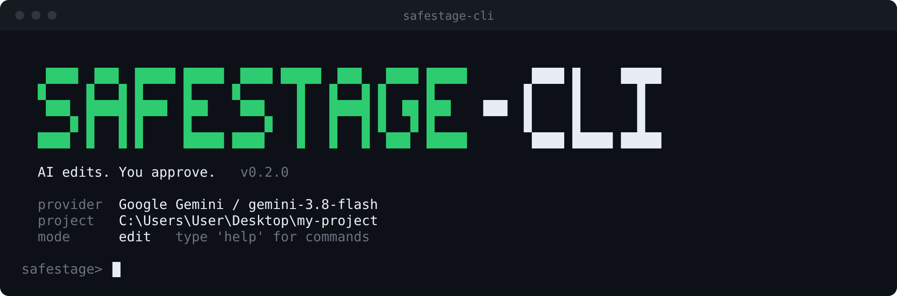
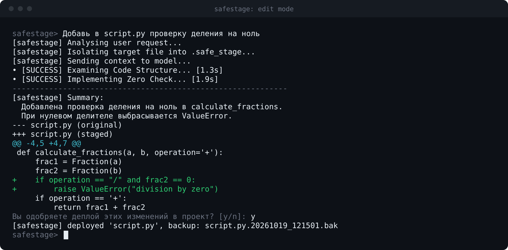
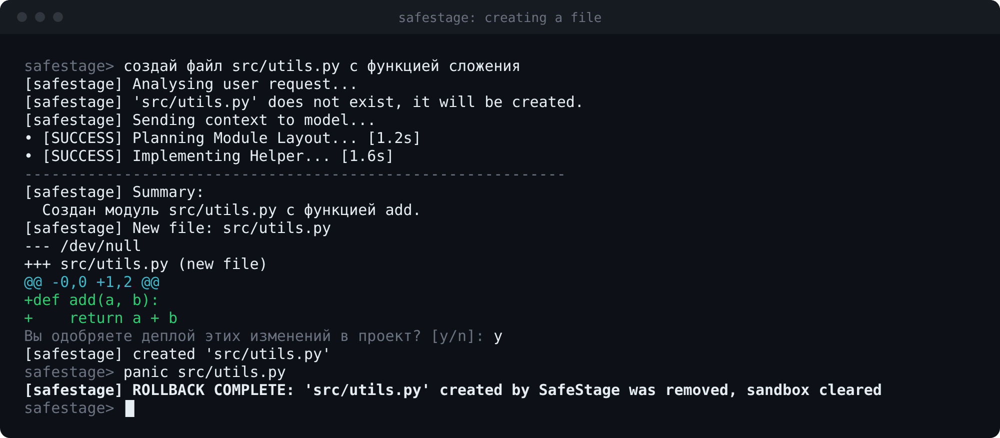
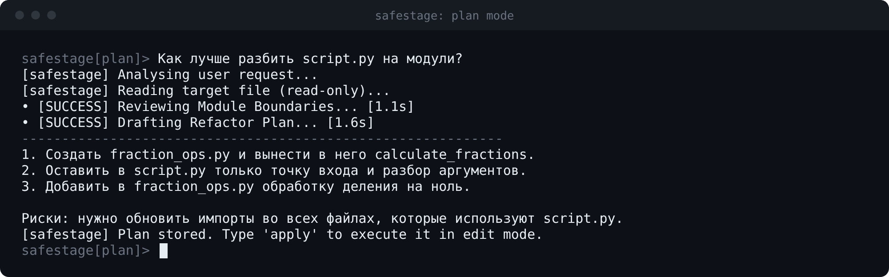
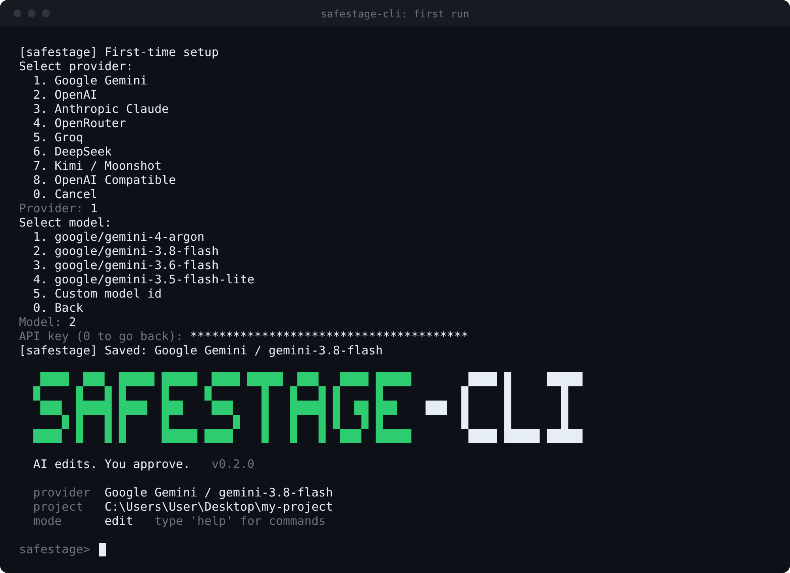

# safestage-cli

AI edits. You approve.

SafeStage is a console tool for editing source files with cloud AI models without letting the model touch your project directly. The model works on an isolated copy, you review the diff, and every deploy leaves a backup you can restore with one command.



## Install

```
pipx install safestage-cli
```

Or with pip:

```
pip install safestage-cli
```

Python 3.9 or newer. After installation, run it from the root of the project you want to edit:

```
cd path/to/project
safestage-cli
```

On the first run SafeStage asks for a provider, a model and an API key.

## How it works

1. **Isolate.** The target file is copied into `.safe_stage`. The model sees only text and never writes to your project. It also gets the list of project files, so it can place new files correctly.
2. **Review.** The model's version is compared with the original and shown as a unified diff. Nothing changes until you answer `y`.
3. **Roll back.** Before a file is replaced, the original is saved to `.safe_backups` (same folder structure as the project) as `name.YYYYMMDD_HHMMSS.bak`. `panic <file>` restores the latest backup and clears the sandbox. If SafeStage created the file, `panic` removes it.



## Creating files

The model can create new files, including nested folders, and change several files in one request (up to 10). Every file goes through its own diff review:

```
safestage> create src/utils.py with an add function
```



Paths are confined to the project root. `.git`, `.safe_stage` and `.safe_backups` are never writable.

## Usage

Describe the change in plain language. The target file is detected automatically:

```
safestage> add logging to script.py
safestage> plan how to split script.py into modules
safestage> chat what does Fraction do
```

| Command | Action |
|---|---|
| `<text>` | run in the current mode |
| `edit`, `plan`, `chat` | switch mode, or run once with text after the word |
| `apply` | execute the last plan in edit mode |
| `panic <file>` | restore the latest backup of the file, or remove a file SafeStage created |
| `config` | change provider, model, API key or base URL |
| `model` | change the model of the current provider |
| `reset` | clear chat history |
| `help`, `exit` | list commands, quit |

Modes:

- `edit`: the model changes and creates files and explains what changed, you approve each diff.
- `plan`: the model only describes the changes, files are never modified.
- `chat`: free conversation, no file access.



## Providers

Google Gemini, OpenAI, Anthropic Claude, OpenRouter, Groq, DeepSeek, Kimi / Moonshot and any OpenAI-compatible endpoint. Pick a model from the list or enter a custom model id. Retired models are removed from the lists and flagged with a warning at launch if your saved model is one of them.

Kimi uses the international endpoint `https://api.moonshot.ai/v1`. Keys issued in mainland China work through the `OpenAI Compatible` option with the base URL `https://api.moonshot.cn/v1`.



## Configuration

Settings, including the API key, are stored in a user-level file outside your project:

| System | Path |
|---|---|
| Windows | `%APPDATA%\safestage\config.json` |
| Linux, macOS | `~/.config/safestage/config.json` |

Set `SAFESTAGE_HOME` to use another directory. The key is stored in plain text, so keep the file private. On Linux and macOS it is created with permissions `600`.

Add the working folders to your project's `.gitignore`:

```
.safe_stage/
.safe_backups/
```

## Limits

- At most 10 files per request.
- `panic` restores the latest backup only.
- The model can still produce wrong code. The diff review is the safety net, read it.

## License

MIT
